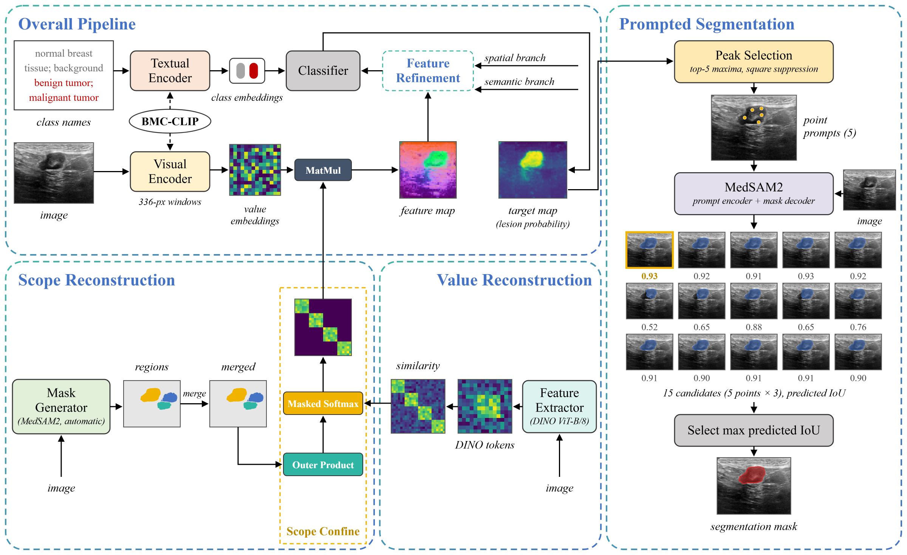

# zsmedseg: segment a medical image from a text description

Give the pipeline an image and a few words such as *"benign tumor, malignant tumor"*, and it
returns the outline of that structure. **Nothing is trained.** Three publicly available,
frozen models are combined, and the only task-specific input is the text.

> **CLIP points, MedSAM2 draws.** A biomedical CLIP model (BMC-CLIP, made dense by CorrCLIP)
> finds *where* the described target is. MedSAM2 then draws *its exact outline*.



**Start here:**
[HOW_TO_RUN.md](HOW_TO_RUN.md) gives step-by-step instructions (local PC, Google Colab, Kaggle), with the output to expect at each step.
[docs/CODE_WALKTHROUGH.md](docs/CODE_WALKTHROUGH.md) explains the code file by file, in the order the data flows.
[AGENTS.md](AGENTS.md) is the whole project on one page (for AI assistants and new contributors).

---

## Results

Mean per-image Dice on the full test sets. The settings are the same for every dataset;
only the text prompts change.

| Dataset (test images) | Target | Dice | Best published zero-shot |
|---|---|---|---|
| UDIAT breast ultrasound (113) | tumour | **82.19** | 77.76 (MedCLIP-SAMv2) |
| COVID-QU-Ex chest X-ray (957) | both lungs | **94.59** | 75.79 (MedCLIP-SAMv2) |
| ISIC 2018 dermoscopy (1000) | skin lesion | **90.40** | none published |
| Kvasir-SEG colonoscopy (1000) | polyp | **88.39** | none published |
| REFUGE2 fundus photographs (400) | optic disc | **81.57** | none published |
| BUSI breast ultrasound (780) | lesion | **76.96** | none published |

On UDIAT the result is on par with the fully supervised nnU-Net (82.47). UDIAT and chest X-ray
follow the evaluation protocol of MedCLIP-SAMv2 (Koleilat et al., 2025), so those two rows are
directly comparable with its published numbers.

---

## How it works

| Step | What happens | Code |
|---|---|---|
| 1. Text to vectors | Each class phrase is put into 12 medical sentence templates and embedded by BMC-CLIP's text encoder; templates and synonyms are averaged into one vector per class (background, target). | `models/text_encoder.py` |
| 2. Regions | MedSAM2's automatic mode splits the image into object-like regions. | `saliency/regions.py` |
| 3. Patch features | The image is scanned with 336 x 336 windows. CorrCLIP rebuilds BMC-CLIP's last attention: each patch averages the features of patches that look alike according to DINO **and** lie in the same region. | `models/corrclip.py`, `models/dino.py` |
| 4. Target map | Each patch is compared with the class vectors; a softmax gives the probability that the pixel is the target. The map is well localised but blurry. | `saliency/estimator.py` |
| 5. Points | The 5 highest, well-separated peaks of the map become point prompts. | `prompting/strategies.py` |
| 6. Outlines | MedSAM2 receives the original image and each point, and returns 3 candidate masks per point, each with a predicted IoU. | `models/medsam2.py` |
| 7. Choice | The candidate with the highest predicted IoU is the output. For a target in two parts (both lungs) the two most confident non-overlapping masks are joined. | `selection/rules.py` |

`pipeline.py` runs these steps in order; it is the best file to read first.

---

## Quick start

```bash
git clone <this repository> zeroshot-medseg && cd zeroshot-medseg
pip install torch==2.1.2 torchvision==0.16.2 --index-url https://download.pytorch.org/whl/cu121
pip install -r requirements-exact.txt && pip install --no-deps -e .   # exact versions (Python 3.10/3.11)
git clone https://github.com/bowang-lab/MedSAM2.git          # provides the sam2 package
python -m zsmedseg download-weights                          # BMC-CLIP + MedSAM2, about 5.3 GB
python -m zsmedseg download-data kvasir                      # raw files -> raw/kvasir
python -m zsmedseg prepare-data kvasir                       # -> data/kvasir/images + masks
python -m zsmedseg evaluate -c configs/datasets/kvasir.yaml  # prints Dice 88.39
```

Your own image, no ground truth needed:

```bash
python -m zsmedseg predict --input my_scan.png --target "kidney stone" --background "kidney" "background"
```

The demo website (upload an image, see every step):

```bash
pip install -e ".[web]"
python -m zsmedseg serve          # open http://127.0.0.1:8000
```

The complete instructions, including Colab and Kaggle, are in [HOW_TO_RUN.md](HOW_TO_RUN.md).

---

## Repository layout

```
zeroshot-medseg/
├── README.md                  this file
├── HOW_TO_RUN.md              step-by-step instructions and expected outputs
├── AGENTS.md                  the whole project on one page, for AI assistants / new contributors
├── configs/
│   ├── datasets/              one YAML per dataset: where the files are + the text prompts
│   └── sam2/                  MedSAM2 model definition
├── src/zsmedseg/
│   ├── pipeline.py            ZeroShotSegmenter: the whole method in one place
│   ├── config.py              every setting, with its default and meaning
│   ├── cli.py                 python -m zsmedseg <command>
│   ├── models/                BMC-CLIP, text encoder, DINO, CorrCLIP, MedSAM2 wrappers
│   ├── saliency/              target map (sliding windows) and MedSAM2 regions
│   ├── prompting/             target map -> 5 points
│   ├── selection/             15 candidates -> output mask
│   ├── evaluation/            Dice / IoU / NSD and the dataset loop
│   ├── data/                  reading images and masks, CLIP preprocessing
│   ├── tools/                 download weights and datasets, convert datasets
│   ├── webapp/                the demo website (FastAPI + plain HTML/CSS/JS)
│   └── utils/                 device choice, logging, drawing
├── scripts/evaluate_all.py    run every dataset and print one results table
├── notebooks/quickstart.ipynb Colab / Kaggle notebook (all datasets)
├── docs/                      CODE_WALKTHROUGH.md, figures
└── tests/                     fast CPU tests (no weights needed)
```

---

## Limitations

* **The target must look different from its surroundings.** When it does not (brain tumours
  in MRI, Dice 49.5), BMC-CLIP cannot point to it.
* **Large, textured organs.** Inside an organ full of fine structure (lungs in CT, Dice 12.9;
  the heart's left ventricle in echocardiography, Dice 2.9) a single point makes MedSAM2
  outline only a small part.
* **All or nothing.** If none of the five points lands on the target, the whole result is wrong.
* **Always predicts a mask**, also for images without a target. Targets made of two parts
  (both lungs) need `selection.num_objects: 2` in their config.

---

## Acknowledgements and licences

The pipeline uses, and requires, the following works. Please cite them and respect their licences.

* **BMC-CLIP / BIOMEDICA**: Lozano et al., *BIOMEDICA: An Open Biomedical Image-Caption Archive, Dataset, and Vision-Language Models Derived from Scientific Literature*, CVPR 2025. [arXiv:2501.07171](https://arxiv.org/abs/2501.07171)
* **CorrCLIP**: Zhang, Liu, Tang, *CorrCLIP: Reconstructing Patch Correlations in CLIP for Open-Vocabulary Semantic Segmentation*, ICCV 2025. [arXiv:2411.10086](https://arxiv.org/abs/2411.10086)
* **MedSAM2**: Ma et al., *MedSAM2: Segment Anything in 3D Medical Images and Videos*, 2025. [arXiv:2504.03600](https://arxiv.org/abs/2504.03600), [code](https://github.com/bowang-lab/MedSAM2) (Apache-2.0), built on **SAM 2** by Meta AI.
* **DINO**: Caron et al., *Emerging Properties in Self-Supervised Vision Transformers*, ICCV 2021.
* **OpenCLIP**: Ilharco et al., [mlfoundations/open_clip](https://github.com/mlfoundations/open_clip) (MIT).
* **Evaluation protocol** for UDIAT, lung X-ray, brain MRI and lung CT: Koleilat et al., *MedCLIP-SAMv2*, Medical Image Analysis 2025.
* **Datasets**: BUSI (Al-Dhabyani et al., 2020), UDIAT (Yap et al., 2018), COVID-QU-Ex (Tahir et al., 2021),
  ISIC 2018 (Codella et al., 2019), Kvasir-SEG (Jha et al., 2020), REFUGE2 (Fang et al., 2022),
  CAMUS (Leclerc et al., 2019), brain tumour MRI (Cheng et al., 2015), lung CT (Konya, 2020).

Authors: Umesh Krishna and Ganesh Bugatha, IIT (BHU) Varanasi, supervised by Dr. Indra Deep Mastan.
